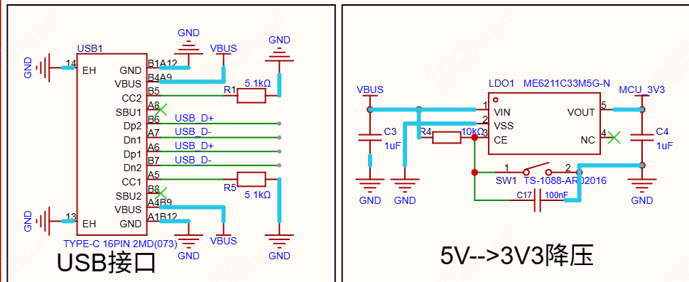
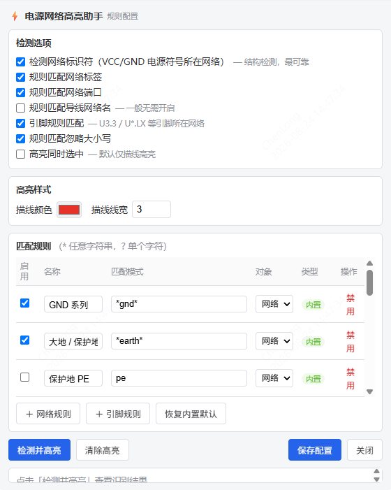

# 电源网络高亮助手 (Power Net Highlighter)

一键识别原理图中的电源网络，并沿导线描线高亮显示。无需逐个点击查找，电源走线分布一目了然，特别适合快速审查电源树、核对地网络连接。

## 功能特性

### 双通道检测

1. **结构检测**：自动扫描原理图中的网络标识符（VCC / GND 等电源符号），其所在网络视为电源网络；
2. **网络名规则**：按通配符规则匹配网络标签、网络端口、导线网络名（如 `*gnd*`、`vcc*`、`+*`）；
3. **引脚规则**：按通配符匹配 `位号.引脚号` / `位号.引脚名`（如 `U3.3`、`U*.LX`），命中引脚所在的物理网络整组高亮，**支持无名称网络**；
4. **电源贯通传播**：电源网络跨 2 引脚电感/磁珠（位号字母前缀精确匹配 `L`/`FB`，可配置，`LED1`/`LS1` 等不会误判）或毫欧级采样电阻（`R` 前缀且阻值低于阈值，默认 < 1Ω）后，对侧网络整组同为电源网络，支持多级链式传播（LC 滤波、采样电阻场景不再"断链"）。

### 高亮机制

- 通过指示器标记沿导线描线高亮，**不随画布点击消失**，可长期保持供审查；
- 高亮颜色与线宽均可配置；
- 可选「同时选中网络」，配合 EDA 自带的选中高亮加深效果；
- 未连导线的电源符号 / 命中引脚会沿其朝向绘制短标识线，避免遗漏。

### 规则配置面板

- 内置 15+ 条常用规则（GND 系列、大地/保护地、VCC/VDD/VEE、正负电压轨、VBAT/VBUS/VSYS、DCDC 开关节点 LX/PH/SW、稳压输出 VOUT 等），可单独启用 / 禁用 / 修改模式；
- 支持新增自定义「网络规则」与「引脚规则」，通配符语法：`*` 任意字符串、`?` 单个字符；
- 检测通道可按需开关（网络标识符 / 网络标签 / 网络端口 / 导线网络名 / 引脚 / 电源贯通传播），贯通传播可配置位号前缀与毫欧电阻阈值(Ω)；
- 支持忽略大小写开关；
- 一键恢复内置默认规则；
- 配置面板内可直接「检测并高亮」实时预览效果。

## 使用方法

1. 在 EasyEDA Pro 中打开需要分析的**原理图页面**；
2. 点击菜单栏 **「⚡ 电源网络」**：
   - **识别并高亮电源网络** — 扫描当前页面，高亮所有命中的电源网络，并以消息提示命中清单；
   - **清除高亮** — 清除全部指示器标记与选中状态；
   - **规则配置...** — 打开配置面板，自定义规则与高亮样式；
3. 在配置面板中调整规则后点击「保存配置」，设置持久保存，下次启动自动生效。

## 内置规则示例

| 规则 | 模式 | 类型 | 默认 |
|---|---|---|---|
| GND 系列 | `*gnd*` | 网络 | 启用 |
| 大地 / 保护地 | `*earth*` | 网络 | 启用 |
| VCC 电源 | `vcc*` | 网络 | 启用 |
| VDD 电源 | `*vdd*` | 网络 | 启用 |
| VEE 负电源 | `*vee*` | 网络 | 启用 |
| 电压轨 (+3V3/+5V/...) | `+*` | 网络 | 启用 |
| 负电压轨 (-5V/...) | `-*` | 网络 | 启用 |
| 电池 VBAT | `*vbat*` | 网络 | 启用 |
| USB VBUS | `vbus*` | 网络 | 启用 |
| 系统电源 VSYS | `vsys*` | 网络 | 启用 |
| DCDC 开关节点 LX | `*.lx` | 引脚 | 启用 |
| DCDC 开关节点 PH | `*.ph` | 引脚 | 启用 |
| 稳压输出 VOUT | `*.vout*` | 引脚 | 启用 |

## 说明

- 检测与高亮均作用于**当前激活的原理图页面**，多页原理图请逐页执行；
- 高亮标记为编辑器指示器，不会修改原理图源数据，清除高亮即可还原；
- 引脚规则按连通性整组标记，同一物理网络内即使导线未命名也会被完整高亮。

## 环境要求

- EasyEDA Pro（嘉立创EDA专业版）≥ 3.2.0

## 开发者文档

源码结构、核心算法与修改指南见 [docs/CODE_GUIDE.md](docs/CODE_GUIDE.md)。打包：`powershell -ExecutionPolicy Bypass -File package.ps1`，输出至 `release/`。

## 许可证

[Apache-2.0](https://www.apache.org/licenses/LICENSE-2.0)
